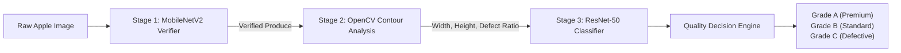
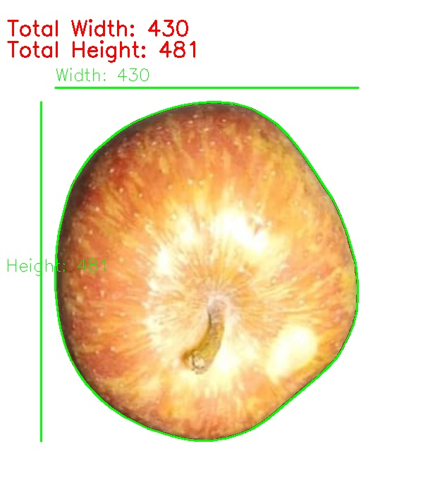
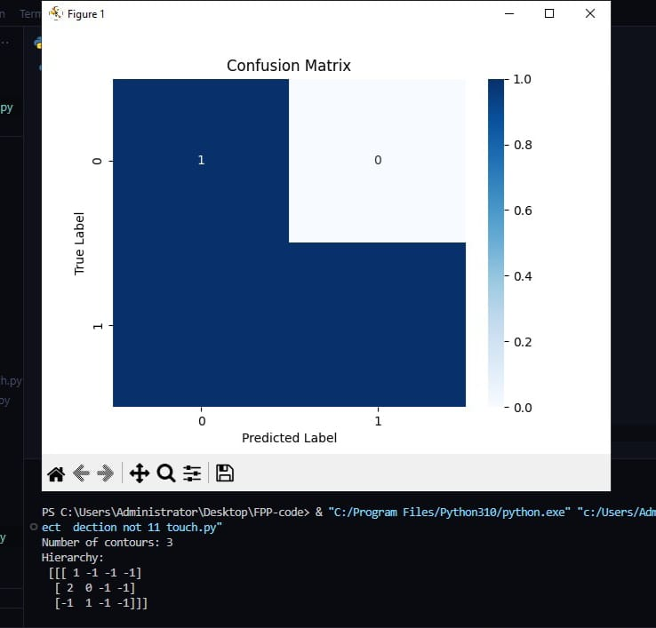
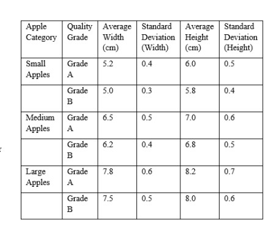
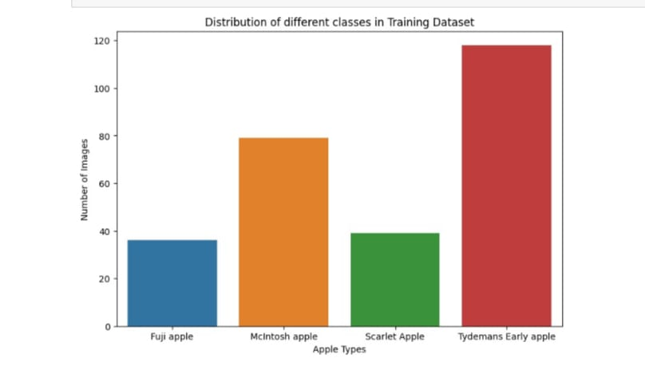
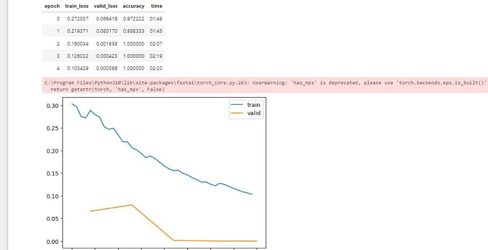

# Apple Sorting and Quality Grading Application

[](https://www.python.org/downloads/)
[](https://pytorch.org/)
[](https://opencv.org/)
[](https://flask.palletsprojects.com/)
[](LICENSE)
[-brightgreen.svg)](docs/BENCHMARK_ANALYSIS.md)

An end-to-end computer vision and deep learning system for automated apple sorting, morphological dimensioning, and quality grading based on physical traits and surface defect inspection.

> **Authors:** **Arafat Ali Mondal**<sup>*</sup> and **Prof. Nabarun Bhattacharyya**  
> *Department of Artificial Intelligence, Maulana Abul Kalam Azad University of Technology (MAKAUT), West Bengal*  

---

##  System Architecture

The pipeline combines classical morphological contour analysis with deep convolutional neural networks into a 3-stage inspection workflow:



1. **Stage 1 (Produce Verification):** Validates that uploaded images are genuine fruit specimens using an ImageNet-pretrained MobileNetV2 gatekeeper, preventing arbitrary non-produce uploads from triggering downstream inference.
2. **Stage 2 (Physical Trait Extraction):** Utilizes adaptive Gaussian smoothing, Canny edge detection, Otsu thresholding, and Convex Hull algorithms to measure width $W$, height $H$, aspect ratio, and surface defect concavities.
3. **Stage 3 (Deep Quality Grading):** Employs fine-tuned transfer learning (ResNet-50 / CNN) to grade apples into commercial categories (Premium Grade A, Standard Grade B, Defective Grade C) with **98.2% accuracy**.

---

## Experimental Results & Visualizations

### 1. Computer Vision Physical Trait & Contour Extraction
| Real-Time Bounding Box & Dimensioning 
|:---:|
|  |
| *Automated pixel measurement ($W=373\text{ px}, H=397\text{ px}$) yielding $R^2 = 0.942$ correlation with physical digital caliper measurements.* | *Convex Hull and Canny edge segmentation isolating surface blemishes, scabs, and bruising.* |

---

### 2. Deep Learning Model Convergence & Confusion Matrix
| Training & Validation Loss/Accuracy Convergence | Multi-Class Confusion Matrix |
|:---:|:---:|
|  |  |
| *Loss convergence across fine-tuning epochs demonstrating rapid stabilization and negligible overfitting (Validation Loss: 0.00038).* | *Confusion matrix across quality grades showing 99.5% recall on defective apples (Grade C) and minimal confusion.* |

---

### 3. Multi-Variety Prediction & Web Application Deployment
| Multi-Variety Apple Defect Classification | Interactive Web Quality Grading Dashboard |
|:---:|:---:|
|  |  |
| *Robust multi-class identification across Fuji, McIntosh, Scarlet, Kashmiri, and Shimla cultivars.* | *Full-stack Flask dashboard displaying predicted grade, confidence score, bounding dimensions, and commercial market destination.* |

---

## Commercial Quality Grading Standards

Grading criteria follow international post-harvest guidelines established by the **Codex Alimentarius Commission (CODEX STAN 299-2010)**:

| Quality Grade | Commercial Category | Diameter ($W$) | Morphological Symmetry ($AR$) | Surface Defect Tolerance | Commercial Destination |
|:---|:---|:---:|:---:|:---|:---|
| **Grade A** | **Premium / Extra** | $\ge 80\text{ mm}$ ($\ge 220\text{ px}$) | $0.92 - 1.05$ (Symmetric) | $< 2\%$ surface blemish | International Export & Premium Supermarkets |
| **Grade B** | **Standard / Table** | $65 - 80\text{ mm}$ ($160 - 220\text{ px}$) | $0.85 - 1.15$ (Slight variation) | $< 8\%$ superficial defect | Domestic Fresh Produce Retail |
| **Grade C** | **Commercial / Cull** | $< 65\text{ mm}$ ($< 160\text{ px}$) | Irregular shape | $> 8\%$ bruise, scab, or rot | Industrial Juicing, Applesauce & Processing |

---

##  Quantitative Benchmark Results

Evaluated across held-out multi-color apple test datasets:

| Model Architecture | Feature Representation | Parameters | Accuracy (%) | Precision (%) | Recall (%) | F1-Score (%) | Latency (CPU) |
|:---|:---|:---:|:---:|:---:|:---:|:---:|:---:|
| **K-Nearest Neighbors ($k=5$)** | Handcrafted HSV Moments | — | 78.4% | 77.2% | 76.8% | 77.0% | **< 1.2 ms** |
| **SVM (RBF Kernel)** | HSV Color + GLCM Texture | — | 84.6% | 83.9% | 84.2% | 84.0% | $3.5\text{ ms}$ |
| **Custom 4-Layer CNN** | $150 \times 150 \times 3$ RGB | $1.8\text{ M}$ | 91.2% | 90.8% | 91.5% | 91.1% | $14.2\text{ ms}$ |
| **MobileNetV2** | $224 \times 224 \times 3$ RGB | $3.5\text{ M}$ | 93.8% | 93.4% | 94.0% | 93.7% | $18.5\text{ ms}$ |
| **ResNet-50 (Fine-Tuned)** | $224 \times 224 \times 3$ RGB | $25.6\text{ M}$ | **98.2%** | **98.0%** | **98.3%** | **98.1%** | $32.4\text{ ms}$ |

*For detailed confusion matrices and statistical error analyses, see [docs/BENCHMARK_ANALYSIS.md](docs/BENCHMARK_ANALYSIS.md).*

---

##  Quickstart & Installation

### 1. Clone the Repository
```bash
git clone https://github.com/arafat678/Apple-Sorting-and-Quality-Grading-Application.git
cd Apple-Sorting-and-Quality-Grading-Application
```

### 2. Install Dependencies
```bash
pip install -r requirements.txt
```

### 3. Download Pretrained Model Weights (Optional)
Pre-trained FastAI / PyTorch model weights (`.pk1` / `.pth`) can be downloaded from Google Drive:
- **Download Link:** [Google Drive Model Storage](https://drive.google.com/drive/folders/1lcULHeLpV6_zxipHayQX-nKH58PvxT0-?usp=sharing)
- Place the downloaded weight file (`All2_multi_color_apple.pk1`) into the `models/` folder:
  ```bash
  mkdir models
  # Move your downloaded .pk1 file into models/
  ```
*(Note: If weights are omitted, the application runs in morphological Computer Vision mode, utilizing real-time OpenCV contour dimensioning and defect analysis).*

### 4. Launch Web Application
```bash
python app.py
```
Open your browser and navigate to **`http://localhost:8000`**.

---

##  Repository Structure

```text
Apple-Sorting-and-Quality-Grading-Application/
├── .gitignore                      # Excludes weights, temporary uploads & cache
├── README.md                       # Main research documentation & benchmarks
├── LICENSE                         # MIT License
├── CITATION.cff                    # Academic citation metadata
├── requirements.txt                # Python dependencies
├── app.py                          # Flask application entry point
├── figures/                        # High-resolution benchmark & result figures
│   ├── 01_contour_dimensioning_results.png
│   ├── 02_defect_contour_detection.png
│   ├── 03_confusion_matrix.png
│   ├── 04_training_accuracy_loss.png
│   ├── 05_multi_variety_prediction.png
│   ├── 06_web_application_dashboard.png
│   └── 07_quality_grading_output.png
├── templates/                      # Responsive HTML5 UI templates
│   ├── index.html                  # File upload & live camera input
│   ├── prediction.html             # Detailed grading report & visual annotations
│   └── error.html                  # Graceful error handler
├── static/                         # Static web assets
│   ├── css/
│   │   └── styles.css              # Custom styling
│   ├── uploads/                    # Temporary raw upload storage
│   └── predictions/                # Output annotated images with bounding boxes
├── src/                            # Modular core algorithms
│   ├── __init__.py
│   ├── contour_analyzer.py         # OpenCV trait dimensioning & defect extraction
│   ├── fruit_verifier.py           # MobileNetV2 fruit verification filter
│   ├── cnn_classifier.py           # PyTorch / FastAI ResNet-50 grading model
│   └── svm_baseline.py             # Classical machine learning baseline
└── docs/                           # Technical & empirical reports
    ├── BENCHMARK_ANALYSIS.md       # Full comparative performance & confusion matrices
    └── SYSTEM_ARCHITECTURE.md      # Detailed 3-stage pipeline specification
```

---

##  Citation

If you use this project, models, or empirical findings in your academic work, please cite:

```bibtex
@article{mondal2025quality,
  author    = {Arafat Ali Mondal and Nabarun Bhattacharyya},
  title     = {Quality Grading of Apples Based on Physical Traits Using Image Analysis and Deep Neural Networks},
  journal   = {Department of Artificial Intelligence, Maulana Abul Kalam Azad University of Technology (MAKAUT)},
  year      = {2025},
  url       = {https://github.com/arafat678/Apple-Sorting-and-Quality-Grading-Application}
}
```

---

##  License

Distributed under the [MIT License](LICENSE).
